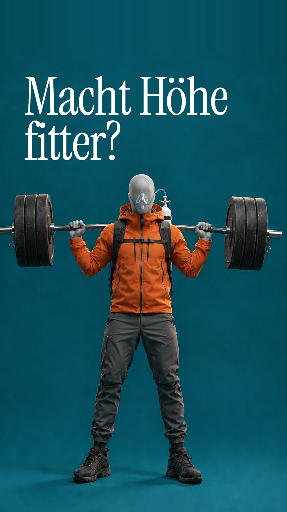

# Erklärvideo mit KI

Making-of der Folge „Macht Höhe fitter?“ und ein Skill, mit dem du so ein Video zu deinem eigenen Thema baust.

<!-- VIDEO -->

Eine Erklärfolge im Hochformat. Die Frage: Was passiert mit dem Körper, wenn man auf über 4.000 Metern trainiert? Eine Figur ohne Gesicht erklärt, echtes Material aus der Serie Iron Summit (Paramount+, 2023) beweist. Hier steht, wie die Folge entstanden ist: Ablauf, Prompts, Werkzeuge und was wir dabei gelernt haben.

| | |
|---|---|
| Länge | 66,7 s; dazu eine Fassung für Webseiten mit einer anderen Stimme, 75,4 s |
| Format | 9:16, 1080 × 1920, 30 Bilder je Sekunde, 18 Bildabschnitte |
| Lautheit | −16 LUFS |
| Stimme | Tariq Khan als Profi-Stimmklon bei ElevenLabs, ruhig, in einem Durchgang |
| Bild | 9 generierte Clips, echtes Material im Leuchtkasten, Schrift und Grafiken per Code |
| Gebaut | am 30. Oktober 2026, fertig in der Nacht auf den 31. |

## Inhalt

- [Ablauf](#ablauf)
- [Aufbau der Folge](#aufbau-der-folge)
- [Werkzeuge](#werkzeuge)
- [Was wir gelernt haben](#was-wir-gelernt-haben)
- [Verworfene Wege](#verworfene-wege)
- [Quellen der Fakten](#quellen-der-fakten)
- [Selbst bauen](#selbst-bauen)
- Prompts zum Kopieren: [prompts/](prompts/)

## Ablauf

1. **Frage und Fakten.** Eine Frage, die man in einem Satz stellen kann. Dazu eine Quellenliste: Studien zur Höhenphysiologie und die Folgen der Serie mit Zeitstempeln. Jede Zahl im Video hat eine Quelle.
2. **Look im Vergleich.** Vier Stile liefen als kurze Tests nebeneinander, darunter Objekte als 3D-Grafik per Code und ein Look nur mit echtem Material. Danach fiel die Wahl auf eine Serienfigur: eine Gliederpuppe ohne Gesicht in oranger Jacke im dunklen Studio. Ein Kurztest in 480p zeigte vor den teuren Clips, dass die Figur in Bewegung gleich bleibt.
3. **Skript.** 13 kurze Sätze, je ein Gedanke. Eine Textprüfung vor der Aufnahme fand einen sachlich falschen Satz und zwei Messwerte, die ohne Erklärung wie ein Widerspruch wirkten. Beides wurde umgeschrieben. Für die Stimme stehen alle Zahlen ausgeschrieben im Text ([sprechtext.txt](prompts/sprechtext.txt)).
4. **Stimme.** ElevenLabs, Modell eleven_v4, der ganze Text in einem Durchgang mit Zeitstempeln. Vorher liefen drei Anweisungen an denselben zwei Sätzen gegeneinander. Die Frage am Anfang kommt aus einem Durchgang, der Rest aus einem zweiten; die Naht liegt in einer Atempause ([stimme-einstellungen.txt](prompts/stimme-einstellungen.txt)).
5. **Zeitkarte.** Die Aufnahme bleibt ungeschnitten. Die Satzanfänge werden im Ton an echten Pausen gemessen (ffmpeg `silencedetect`), nicht aus der Zeitachse geschätzt. Eine Zeitdatei steuert danach Bildabschnitte, Schrift, Untertitel und Effekte.
6. **Startbilder und Clips.** Je Szene ein Startbild mit GPT Image 2.5, daraus ein Clip mit Wan 3.0 Prime in 720p. Die Figur bleibt gleich, weil jeder Prompt dieselbe Beschreibung wortgleich enthält ([figur-baustein.txt](prompts/figur-baustein.txt)). Clips, die kürzer als ihr Satz sind, laufen leicht verlangsamt mit Zwischenbildern.
7. **Leuchtkasten.** Im Startbild steht ein leerer weißer Leuchtkasten. Ein Python-Skript mit OpenCV setzt Bild für Bild das echte Material hinein: das Poster der Serie, Szenen aus Dschungel und Schnee, die Uhr am Handgelenk, die Messung am Finger. Dann fährt die Kamera hinein, bis das echte Bild den ganzen Screen füllt.
8. **Schrift und Grafiken.** Titel, Zähler, Messwerte, Untertitel und die Schlussgrafiken sind HTML-Seiten. Ein Chrome ohne Fenster rendert sie Bild für Bild als transparente Ebenen, ffmpeg legt sie über das Video. Die Grafik an der Uhr folgt dem Zifferblatt per Kreiserkennung Bild für Bild.
9. **Ton.** Musik von ElevenLabs, fünf Titel zur Auswahl; der gewählte wurde im Takt verlängert. Effekte nur auf Bildereignisse: Zoom, Wind, Donner 0,1 s nach dem sichtbaren Blitz, Zähler, Herzschlag, Hubschrauber. Die Musik duckt sich unter der Stimme (Sidechain), am Ende −16 LUFS.
10. **Prüfen.** Transkript der fertigen Mischung gegen den Sprechtext, Einzelbild an jeder Zahl, jeder Abschnitt in einer Nachbildung der Instagram-Ansicht, das Seitenverhältnis per `ffprobe`, zuletzt auf dem iPhone.

## Aufbau der Folge

| Takt | Gesagt | Bild |
|---|---|---|
| Frage | Was passiert eigentlich mit deinem Körper, wenn du auf über 4.000 Metern trainierst? | Figur am Gipfel, Kniebeuge mit Hantel |
| Echter Beweis | Wir haben es getestet: fünf Teilnehmer, eine 100-Kilo-Hantel, acht Tage durch drei Klimazonen bis ins Basislager der Annapurna. | Figur zeigt auf den Leuchtkasten, darin erst das Poster der Serie, dann echte Szenen |
| Aufbau | Die Hantel in Teilen: Stange von Schulter zu Schulter, Scheiben im Rucksack. | drei Figuren auf Stufen, Stange auf der Schulter, Scheiben im Rucksack |
| Aufbau | Am Handgelenk misst die Galaxy Watch5 Pro von Samsung mit. | Zoom in den Leuchtkasten: die echte Uhr, Grafik mit Höhe und Puls |
| Aufbau | Etappe eins: 14 Stunden zu Fuß, bis zu 15 Liter Wasser pro Kopf. | Figur nachts im Gewitter auf Stufen, Zähler für Stunden und Liter |
| Mechanismus | Oben ist der Sauerstoffanteil gleich, aber die Luft dünner: Jeder Atemzug bringt rund 40 Prozent weniger. | links Meereshöhe, rechts Höhe; dann Blick in die Lunge |
| Messung | Tag fünf, fast 3.000 Meter, im Aufstieg: nur noch 67 Prozent Sauerstoff im Blut. Normal sind um die 98. | zwei Blutbahnen: links alle Blutkörperchen beladen, rechts rund zwei Drittel |
| Messung | Wer Symptome hat, bleibt zurück und akklimatisiert sich. Hilft das nicht, geht es runter. | eine Figur sitzt auf der Stufe, zwei steigen weiter |
| Messung | Ganz oben, auf 4.200 Metern, wird die Hantel zusammengebaut. Kurze, schwere Sätze gehen fast wie unten. | zwei Figuren stecken die Scheiben auf, dann echt: das Training oben |
| Kipppunkt | Am Morgen danach geht es einem Teilnehmer schlecht, 68 Prozent. Er fliegt mit dem ersten Hubschrauber runter. | Zoom in den Leuchtkasten: echte Messung am Finger, Einblendung „68 % Sauerstoff im Blut, am Finger gemessen, normal 98 %“, dann der Hubschrauber |
| Erkenntnis | Macht Höhe fitter? Kaum. Für deutlich mehr rote Blutkörperchen braucht der Körper drei bis vier Wochen auf 2.000 bis 2.500 Metern. Und zurück im Tal baut er das Plus in wenigen Wochen wieder ab. | Schlussgrafiken: acht Tage gegen drei bis vier Wochen, dann der Abbau im Tal |

## Werkzeuge

| Werkzeug | Wofür | Bezugsquelle |
|---|---|---|
| Claude Code | Recherche, Skript, alle Skripte für Schnitt, Ebenen und Mischung | [claude.com/claude-code](https://claude.com/claude-code) |
| Higgsfield | Startbilder (GPT Image 2.5) und Clips (Wan 3.0 Prime) | [higgsfield.ai](https://higgsfield.ai) |
| ElevenLabs | Stimme mit Zeitstempeln, Stimmklon, Musik, Effekte | [elevenlabs.io](https://elevenlabs.io) |
| ffmpeg | Schnitt, Ebenen, Mischung, Lautheit, Prüfung | [ffmpeg.org](https://ffmpeg.org) |
| Python mit OpenCV und NumPy | Leuchtkasten, Kreiserkennung an der Uhr, Satzgrenzen im Ton | [opencv.org](https://opencv.org) |
| Chrome ohne Fenster | Schrift und Grafiken aus HTML als transparente Ebenen | [google.com/chrome](https://www.google.com/chrome/) |
| Whisper | Transkript der Mischung gegen den Sprechtext | [github.com/openai/whisper](https://github.com/openai/whisper) |

## Was wir gelernt haben

1. **Stimme in einem Durchgang.** Satz für Satz erzeugt klang jeder Satz wie ein Neuanfang, geschnittene Übergänge haben Wörter angeschnitten. Seit das Bild der ungeschnittenen Stimme folgt, ist beides weg.
2. **Satzgrenzen im Ton messen.** Schnitte nach der Zeitachse der Stimme trafen Wörter. Die echten Pausen im Ton liegen oft ein paar Zehntel daneben.
3. **Zoom ohne Doppelbild.** Eine Überblendung in den Leuchtkasten zeigte kurz zwei Bilder übereinander. Besser: Das echte Bild ist immer das Vollbild, nur kleiner gezeichnet. Es wächst mit dem Kasten, bis es den Screen füllt.
4. **Kräftige Grafiken.** Eine Abschattung lag über statt unter der Grafik und hat alles ausgewaschen. Das fällt erst am Handy auf, also dort prüfen.
5. **Messwert mit Namen.** „68 %“ allein versteht niemand. „Sauerstoff im Blut, am Finger gemessen, normal 98 %“ schon. Und es muss lange genug stehen bleiben.
6. **Nur nennen, was belegt ist.** Die 68 % wurden mit einem Fingerclip gemessen, nicht mit der Uhr. Darum nennt der Text an dieser Stelle kein Gerät.
7. **Ruhig ist eine Frage des Tempos.** Mit Anweisung und hoher Stabilität wurde die Stimme tiefer und gleichmäßiger. Den Rest machen Pausen: Ein Profisprecher lässt sich mehr Zeit.
8. **Jeden Clip absuchen.** Im Clip mit den Stufen lief eine vierte Figur ins Bild, die kein Prompt verlangt hatte. Sie wurde per Ausschnitt entfernt.
9. **Seitenverhältnis prüfen.** Nach dem Stapeln zweier Bildstreifen stand in der Datei ein Bildpunkt-Verhältnis von 3:2. Player zeigten das Video gestaucht. `setsar=1` nach jedem Stapeln behebt es, `ffprobe` beweist es.
10. **In der echten Ansicht prüfen.** In der Instagram-Ansicht lagen Texte zu weit oben und die Untertitel zu hoch. Alle Elemente rückten 30 bis 140 Pixel nach unten, die Untertitel auf Höhe 1.440 von 1.920 Pixeln.

## Verworfene Wege

- Ein heller Look wie ein anatomisches Präparat.
- Objekte als 3D-Grafik per Code: sauber, aber sie wirkten wie Spielzeug.
- Die Stimme Satz für Satz erzeugen und schneiden.
- Eine erste Fassung mit drei gleichen Figuren; später kam eine Frauenfigur dazu, höchstens drei Figuren im Bild.

## Quellen der Fakten

**Iron Summit**

- [ironsummit.de](https://ironsummit.de): fünf Teilnehmer, eine 100-Kilo-Langhantel; Etappe 1 mit 14 Stunden
- Folge 1, 01:49: acht Tage durch drei Klimazonen; 12:01: die Uhr
- Folge 4, 05:14: 14-Stunden-Wanderung; 40:13: 10 bis 15 Liter Wasser
- Folge 5, 23:04 bis 23:37: wer Symptome hat, bleibt zurück; 29:26 bis 29:49: Tag 5, 2.920 Höhenmeter, Sauerstoffsättigung 67 %
- Folge 6, 30:08: die Langhantel komplett oben; 50:36: Training über dem Camp
- Behind the Scenes 10, 05:33: 68 % Sauerstoffsättigung; 05:46: Flug mit dem ersten Helikopter

**Physiologie**

- West 1996, J Appl Physiol 81:1850, [PMID 8904608](https://pubmed.ncbi.nlm.nih.gov/8904608/): Luftdruck und Sauerstoff in der Höhe
- Staab 2013, High Alt Med Biol 14:13, [PMID 23537255](https://pubmed.ncbi.nlm.nih.gov/23537255/); Dünnwald 2021, Sensors 21:1263, [PMID 33578839](https://pubmed.ncbi.nlm.nih.gov/33578839/): Sauerstoffsättigung auf Meereshöhe und in der Höhe
- Fulco 1998, Aviat Space Environ Med 69:793, [PMID 9715971](https://pubmed.ncbi.nlm.nih.gov/9715971/); Deb 2018, Eur J Sport Sci 18:243, [PMID 29220311](https://pubmed.ncbi.nlm.nih.gov/29220311/): kurze Kraftbelastungen ohne Leistungsverlust
- Gore 2013, Br J Sports Med 47 Suppl 1:i31, [Abstract](https://bjsm.bmj.com/content/47/Suppl_1/i31.abstract): rote Blutkörperchen in der Höhe und nach der Rückkehr
- Pottgiesser 2012, Int J Sports Physiol Perform: Abbau nach dem Höhenlager
- Levine und Stray-Gundersen 1997, J Appl Physiol 83:102, [PMID 9216951](https://pubmed.ncbi.nlm.nih.gov/9216951/): vier Wochen auf 2.500 Metern

## Selbst bauen

- Als Skill für Claude Code und andere Agenten: [skills/erklaervideo](skills/erklaervideo/), installieren mit `npx skills add publicimpact/erklaervideo-mit-ki`
- Als Text zum Weitergeben an deine KI: [prompts/anleitung-fuer-die-ki.md](prompts/anleitung-fuer-die-ki.md)
- Als PDF: [anleitung.pdf](anleitung.pdf)

Das echte Material aus Iron Summit liegt nicht in diesem Repository; die PDF zeigt davon nur kleine Ausschnitte als Beispiel.

Lizenz: Texte, Prompts und Skill unter CC BY 4.0, siehe [LICENSE](LICENSE) und [NOTICE.md](NOTICE.md). Video und Bilder der Folge nur zum Ansehen.

---

Public Impact · [publicimpact.ai](https://publicimpact.ai) · hey@publicimpact.ai
